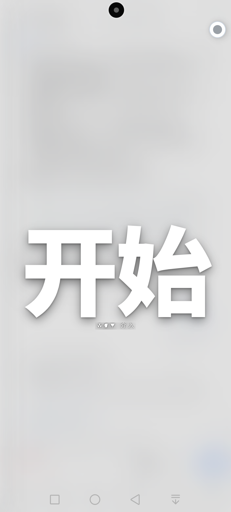
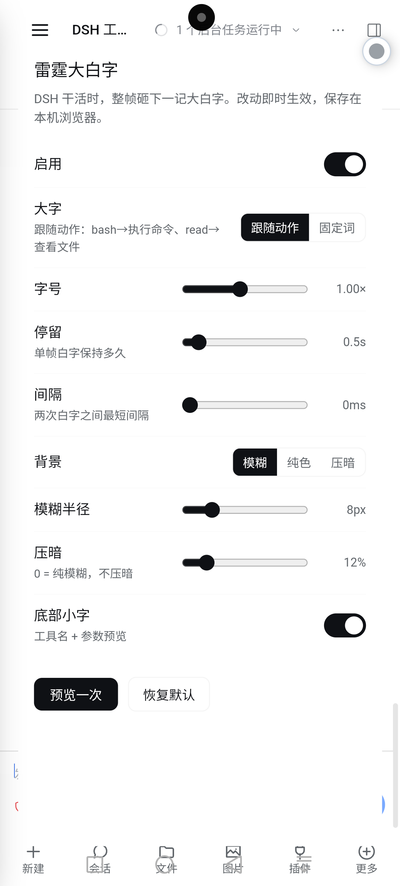

# dsh-thunder-overlay（雷霆大白字）

DSH Web GUI 插件。**当前会话在干活时**，整帧浮层上砸下一记大白字——超大纯白字、故障闪烁、压暗背景，然后淡出；随后每次新的工具调用换一个字。灵感来自游戏《Control》的区域标题卡。

- 挂载点：`shell.overlay`（框架级浮层，盖在所有列之上，不在滚动容器里）
- 触发源：`ctx.uiSession.sessionStatus`（当前会话 `running`）+ 会话事件流里的 `tool/call`
- 纯视觉：`pointer-events: none`，不拦点击、不改任何业务状态

## 触发逻辑

1. **用户发消息**（会话事件流里出现新的 `user/message`）→ 弹「开始」
2. **智能体进入忙碌**（`running` 由空闲变忙碌）→ 弹「忙碌文案」（默认「雷霆」，设置页可改；会让「开始」先露 ~0.3 秒）
3. **智能体干完活**（`running` 由忙碌变空闲）→ 弹「完成文案」（默认「完成」，设置页可改）
4. 之后每出现一次新的 `tool/call` → 换一次动作词（`bash`→执行命令、`web_search`→网络搜索、`run_code`→执行代码……）
5. 每记白字停留 `duration` 毫秒后淡出并卸载；两次之间至少隔 `cooldown`
6. 会话停止后不再新增，最后那帧自然播完

## 设置页

打开 **设置 → 雷霆大白字**，可以直接调：启用开关、四类提示各自的开关（用户发消息弹「开始」／智能体忙碌弹「忙碌文案」／智能体完成弹「完成文案」／工具调用弹动作词）、大字来源（跟随动作／固定词）、忙碌文案、字号、停留时长、间隔、背景方式（模糊／纯色／压暗）、模糊半径、压暗量、底部小字，以及「恢复默认」。

改动即时生效，存在本机浏览器的 `localStorage`（键名 `dsh-thunder-overlay:config`），不写入 profile 配置；换浏览器/清缓存会回到默认值。

## 调参

改 `lib/client.js` 顶部的 `DEFAULTS`，然后刷新页面（客户端半是页面级模块，不需要重启引擎）：

| 键 | 默认 | 含义 |
|---|---|---|
| `enabled` | `true` | 总开关 |
| `mode` | `'action'` | `'action'` 大字跟随动作；`'fixed'` 永远写 `word` |
| `word` | `'开始'` | fixed 模式的大字 / 无动作时的兜底字 |
| `openingWord` | `'开始'` | 用户发消息时弹的字 |
| `busyWord` | `'雷霆'` | 智能体进入忙碌状态时弹的字（设置页可改） |
| `finishWord` | `'完成'` | 智能体干完活时弹的字（设置页可改） |
| `openingDetail` | `'DSH 介入'` | 开场时下方小字 |
| `detail` | `true` | 是否显示下方「工具名 · 参数预览」 |
| `duration` | `2400` | 单帧停留毫秒 |
| `cooldown` | `550` | 两帧最小间隔毫秒 |
| `scale` | `1` | 字号倍率 |
| `veil` | `0.42` | 背景压暗 0~1（怕晃眼就调小） |
| `showBolt` | `false` | 字前的闪电符号 |
| `showRing` | `true` | 冲击波环 |
| `backdrop` | `'solid'` | `'solid'` 整屏色块（标题卡）／`'veil'` 暗角压暗 |
| `backdropColor` | `'#0e1116'` | solid 模式底色 |
| `backdropAlpha` | `0.94` | solid 模式不透明度 |

词表在同文件 `TOOL_WORDS`（`run_code`→执行代码；没收录的工具一律显示「执行」，底部小字里能看到真实工具名）（`bash`→执行命令、`read`→查看文件、`read_image`→查看图片、`web_search`→网络搜索、`subagent`→派出助手……字数不固定，字号按字数自适应铺满屏宽）；也可以用 `labels: { bash: '我的词' }` 覆盖单个工具。

也想不改文件临时试：在 Web GUI 的 console 里

```js
window.__dshThunder = { veil: 0.2, duration: 1800 }
```

然后刷新页面。

## 临时关掉 / 卸载

- 关掉：`DEFAULTS.enabled = false` 后刷新页面
- 卸载：设置 → 插件 → 找到 `dsh-thunder-overlay` 禁用或卸载；或
  `cd ~/../dsh-home/profiles/web && pnpm remove dsh-thunder-overlay`

## 结构

```
package.json        # dsh.bundle.patch + dsh.client 声明
cordis.patch.yml    # 把宿主半插入 loader（宿主半是空 apply）
lib/index.js        # 宿主半：无行为，只为让 bundle 出现在工程里
lib/client.js       # 浏览器半：唯一的实现
```

## 已知边界

- 只认"当前选中的会话"；后台会话在干活不会冒字
- 页面刷新后才加载新版客户端代码（引擎侧宿主半已热生效）
- `prefers-reduced-motion: reduce` 时退化为纯淡入淡出

## 改动如何生效

`profiles/web/node_modules/dsh-thunder-overlay` 现在是指向本目录的软链接：

1. 改完 `lib/client.js` 保存
2. 引擎的 HMR 每 500ms 轮询一次，会把新文件重新打进 bundle（约 1 秒）
3. 在 Web GUI 里刷新一次页面即可看到新效果

如果哪天 pnpm 重新安装把软链接换成了拷贝，重跑一次插件安装（或把目录重新指向本目录）即可。

## 分发

```sh
cd dsh-thunder-overlay
pnpm pack --pack-destination ..
# 产物：dsh-thunder-overlay-0.1.0.tgz
```

对方用 `plugin_manager install_bundle`（target 指向这个 tgz）或 `pnpm add <tgz>` 安装，见 [INSTALL.md](INSTALL.md)。

## 按社区标准发布

1. **包元数据**：`package.json` 已带 `keywords`、`license`、`engines.dsh`，并移除了 `private`（npm publish 需要）
2. **发布**：`npm publish`；包名被占用时改用 scoped 名，例如 `@you/dsh-thunder-overlay`
3. **索引**：仓库根目录的 `market-index.sample.json` 是「插件市场索引 format 1」样例，已用官方校验器验证通过；把 `homepage` / `repository` 换成自己的仓库地址后，托管到任意 https 地址
4. **上架**：用户把该索引 URL 加进插件市场（或市场配置的 `indexes`），即可搜索到并一键安装（安装规格为 `name@version`）
5. **git 源替代**：`versions[].source` 可写成 `{ "type": "git", "url": "https://…", "commit": "<40位SHA>", "path": "可选目录" }`
6. **注意**：索引里的多语言键必须用小写语言 id（`en`、`zh-cn`），且对象形式必须含 `en`；`publishTimestamp` 是 Unix 秒

## 远程字体（不随包分发）

底部的 Endfield 小字**不打包**：运行时从上游仓库抓取（jsDelivr → GitHub raw 依次尝试），成功后缓存在本机 `localStorage`（`dsh-thunder-overlay:font`），失败就退回系统等宽字体。设置页有「远程字体」开关可以关掉。

因此包本身只内嵌了 OFL 授权的 Noto Sans SC 子集，Endfield 不参与再分发。

## 截图




